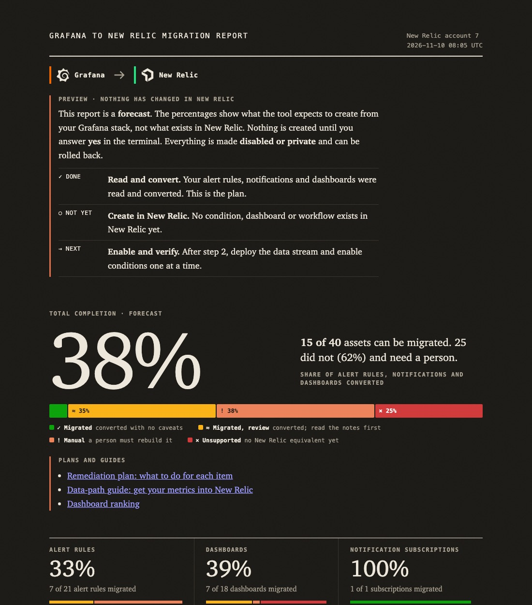
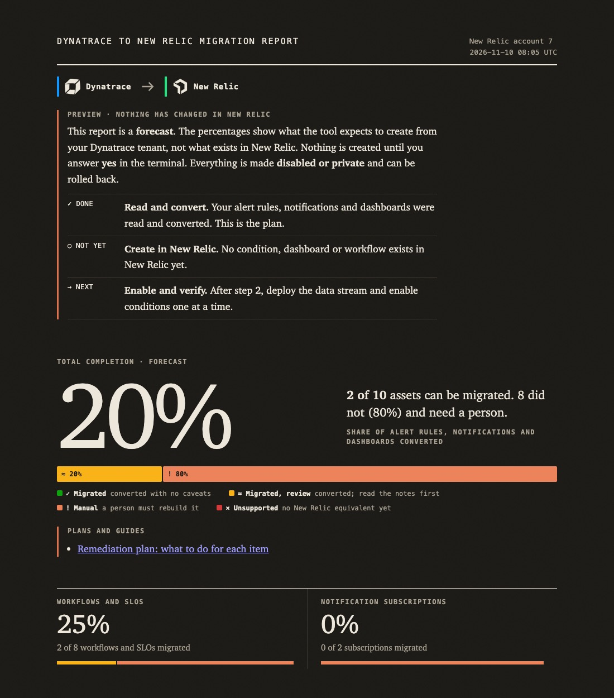
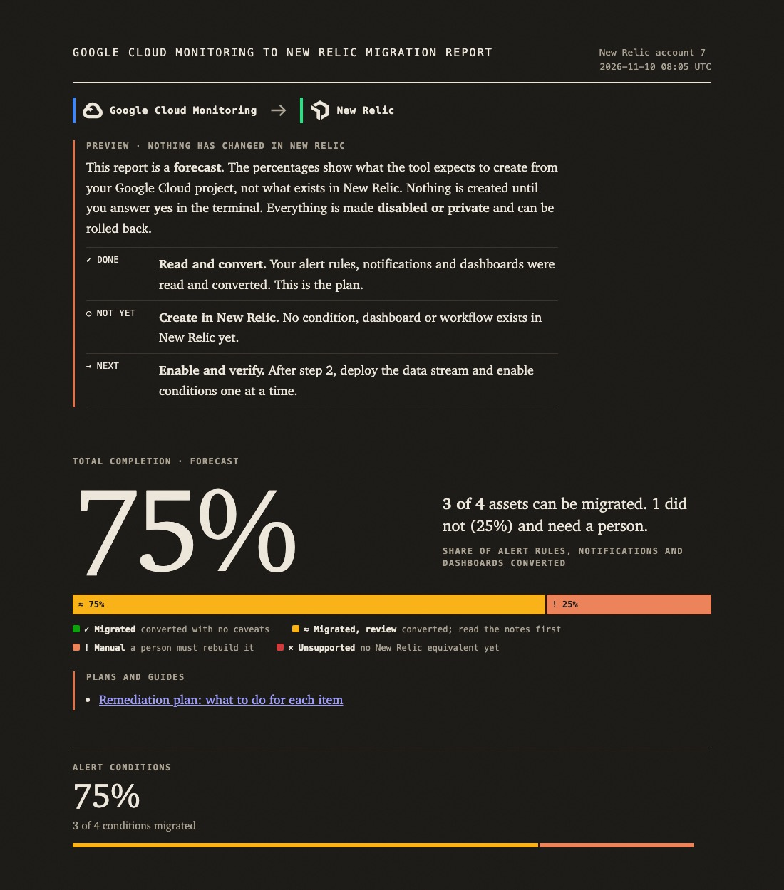
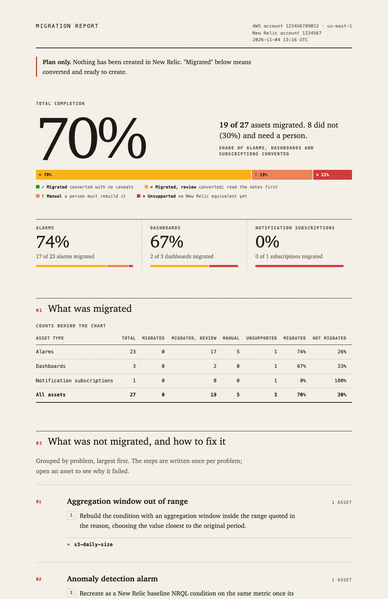
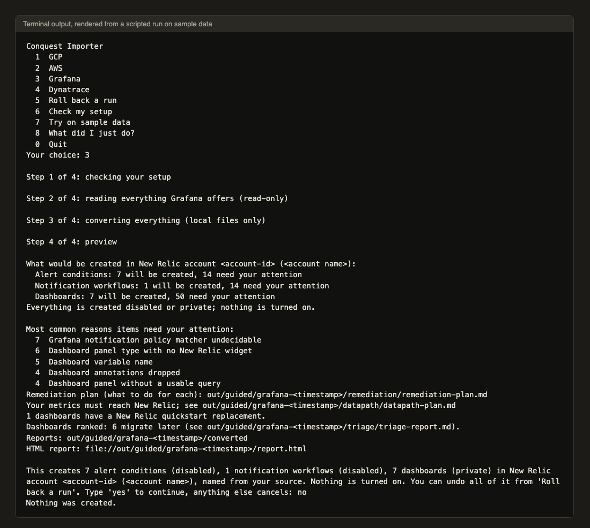
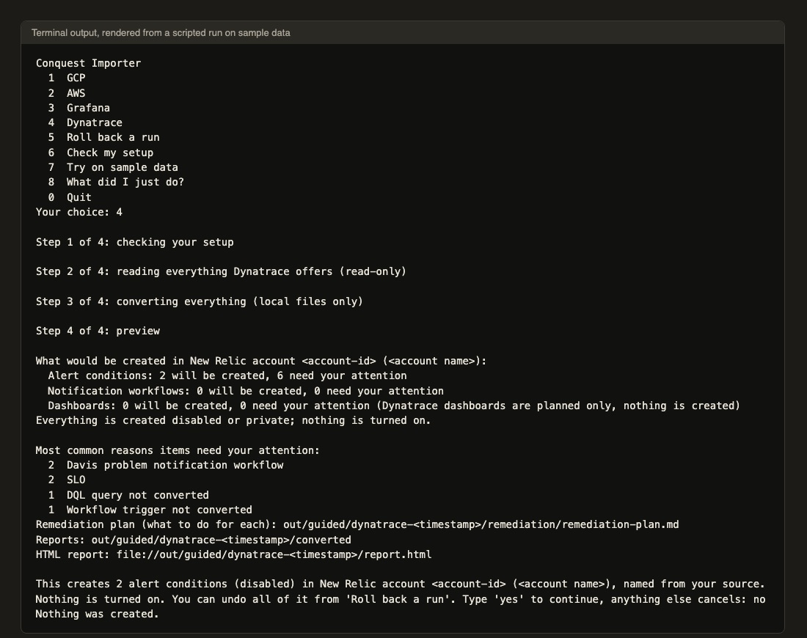

# Conquest Importer

[](LICENSE)
[](https://github.com/acidbathory/conquest-importer/actions/workflows/ci.yml)

Moves monitoring from Grafana, Dynatrace, AWS CloudWatch or Google Cloud Monitoring to New Relic:
alerts, notifications and dashboards, with a report of what moved, what did not, and how to fix the
rest.

> Status: prototype. Nothing has been verified on a customer estate. Every converted item is created
> disabled (alerts, workflows) or private (dashboards), and you must check each one before you
> enable it. The tool only reads your source system and only creates things in New Relic; it never
> changes or deletes anything on the source side, and `importer rollback` / the menu's "Roll back a
> run" removes what a run created.

## Supported sources

| Source | State | Tested live | Not proven |
|---|---|---|---|
| [Grafana](docs/user/runbook-grafana.md) | Early. Alert rules on plain Prometheus selectors and Loki `count_over_time` convert; many dashboards convert in part | An alert firing test and metric round trips in a sandbox | Notifications (offline plans only), customer data |
| [Dynatrace](docs/user/runbook-dynatrace.md) | Least proven. Scheduled DQL log-count workflows convert; Davis problem workflows, SLOs and dashboards are plans with manual steps | A read-only check of one Platform tenant; test objects created and removed in a sandbox | Any converted item firing in New Relic; no automatic data path |
| [AWS CloudWatch](docs/user/runbook-aws-cloudwatch.md) | Most tested. Alarms, dashboards, SNS notifications, Metric Streams Terraform | A real AWS account, end to end with data | Metric names outside the verified list |
| [Google Cloud Monitoring](docs/user/runbook-gcp.md) | Alert policies and dashboards convert | A sandbox project, including the data link | VM CPU data does not arrive; no firing test |
| Datadog | Paused (built, then removed) | | [Details](docs/user/runbook-datadog-and-azure.md) |
| Azure | Not started | | [Details](docs/user/runbook-datadog-and-azure.md) |

Sample exports in `tests/fixtures` cover the working sources, so the tests and the images below run
without any account. The menu has a "Try on sample data" item (7).

## What you need

Pick your source. Each table lists everything to have in hand before you start. Values go in a `.env`
file in the repository root (git-ignored; copy `.env.example`). Never paste real values into tickets or
chat. UNVERIFIED means the permission or scope has not been seen working on a live system: start
read-only and add only what an error asks for.

### Prerequisites: Grafana to New Relic

| | |
|---|---|
| Accounts and roles | A Grafana Cloud stack, or a self-hosted Grafana over https, and someone who can create a service account there |
| Credential | A Grafana service account token, read-only (start with the Viewer role). The importer sends only `GET` requests. UNVERIFIED: the exact Grafana RBAC action each endpoint needs. Check the token's real permissions (`GET /api/access-control/user/permissions`) before use: a "Viewer" token in our sandbox held alerting write permissions |
| `.env` variables | `GRAFANA_URL` (`https://<stack>.grafana.net`; self-hosted needs `--allow-host`), `GRAFANA_SA_TOKEN` |
| Install | Python 3.12+, [uv](https://docs.astral.sh/uv/), `uv sync` |
| New Relic | A User API key (`NRAK-...`) in `NEW_RELIC_API_KEY`, only to create things and to run data checks; the target account in `NEW_RELIC_ACCOUNT_ID`; the same id in `NEW_RELIC_ALLOWED_ACCOUNT_IDS`; EU accounts add `--region eu`. A plan-only run needs no New Relic key. An ingest licence key is not needed by the importer |
| Network | Grafana reachable over https. Behind a TLS-inspecting proxy, set `SSL_CERT_FILE` to the corporate root certificate (PEM) |
| Start | `bash scripts/migrate.sh`, then choose `3` |

### Prerequisites: Dynatrace to New Relic

| | |
|---|---|
| Accounts and roles | A Dynatrace Platform tenant (`https://<env-id>.apps.dynatrace.com`), and someone who can create a platform token. Classic tenants (`<env-id>.live.dynatrace.com`) work only with `extract-dynatrace-classic` |
| Credential | A platform token, read-only. Workflows and SLOs: `automation:workflows:read`, `slo:slos:read`. Classic alerting settings: `settings:objects:read`, `settings:schemas:read`. Dashboards, synthetics and entities: UNVERIFIED, scopes not confirmed live (start read-only, add what a 403 asks for) |
| `.env` variables | `DYNATRACE_ENV_URL`, `DYNATRACE_API_TOKEN`; optional `IMPORTER_DYNATRACE_METRIC_MAP` |
| Install | Python 3.12+, [uv](https://docs.astral.sh/uv/), `uv sync` |
| New Relic | User API key (`NRAK-...`) in `NEW_RELIC_API_KEY`, only to create things and for data checks; `NEW_RELIC_ACCOUNT_ID`; `NEW_RELIC_ALLOWED_ACCOUNT_IDS`; EU accounts add `--region eu`. No ingest licence key is used by the importer, and there is no automatic route for OneAgent data |
| Network | Tenant reachable over https. Behind a TLS-inspecting proxy, set `SSL_CERT_FILE` to the corporate root certificate (PEM) |
| Start | `bash scripts/migrate.sh`, then choose `4` |

### Prerequisites: AWS CloudWatch to New Relic

| | |
|---|---|
| Accounts and roles | An AWS account and an IAM user or role you can revoke afterwards. One account and one region per run |
| Credential | Read-only AWS access: the short policy in [permissions](docs/permissions.md#aws-cloudwatch) (CloudWatch alarms and dashboards, SNS subscriptions; optional log, EventBridge and other read actions). AWS keys from the environment, or a named profile (`--profile`) |
| `.env` variables | Usually none: `AWS_ACCESS_KEY_ID`, `AWS_SECRET_ACCESS_KEY`, `AWS_SESSION_TOKEN` only if you have no login or profile on the machine |
| Install | Python 3.12+. For the guided menu also [uv](https://docs.astral.sh/uv/). The AWS CLI is not needed. Terraform only to stream metric data |
| New Relic | User API key (`NRAK-...`) in `NEW_RELIC_API_KEY` to create things; `NEW_RELIC_ACCOUNT_ID`; `NEW_RELIC_ALLOWED_ACCOUNT_IDS`; EU accounts add `--nr-region eu`. A separate ingest licence key is used only by the Metric Streams Terraform you deploy yourself (`TF_VAR_newrelic_license_key`); the importer never reads it |
| Network | AWS and New Relic reachable over https. Behind a TLS-inspecting proxy, set `SSL_CERT_FILE` |
| Start | `importer migrate` (AWS only), or `bash scripts/migrate.sh` and choose `2` |

### Prerequisites: Google Cloud Monitoring to New Relic

| | |
|---|---|
| Accounts and roles | A Google Cloud project and a Google login that can read Cloud Monitoring. To link the project for data, someone who can create a service account and workload identity pool and grant IAM roles |
| Credential | Read-only: Monitoring Viewer (`roles/monitoring.viewer`). UNVERIFIED: that this is the minimum. Sign in with `gcloud auth application-default login`, or set a short-lived access token |
| `.env` variables | Optional `GOOGLE_OAUTH_ACCESS_TOKEN` (otherwise the gcloud login is used) |
| Install | Python 3.12+, [uv](https://docs.astral.sh/uv/), `uv sync`, the `gcloud` CLI for the login, Terraform to deploy the data link |
| New Relic | User API key (`NRAK-...`) in `NEW_RELIC_API_KEY`, to create things and for the data check (the link Terraform also reads it from the environment); `NEW_RELIC_ACCOUNT_ID`; `NEW_RELIC_ALLOWED_ACCOUNT_IDS`; EU accounts add `--region eu` / `--nr-region eu` |
| Network | Google and New Relic reachable over https. Behind a TLS-inspecting proxy, set `SSL_CERT_FILE` |
| Start | `bash scripts/migrate.sh`, then choose `1` |

Check your setup without any network call: `importer doctor --source grafana` (or `dynatrace`, `gcp`).
The exact permission lists, ready to copy, are in [docs/permissions.md](docs/permissions.md).

## Start here

The guided menu is the one-command start. It asks which source, reads it (read-only), converts
everything on your machine, shows a preview and the HTML report, and creates nothing until you type
`yes`.

```sh
git clone https://github.com/acidbathory/conquest-importer.git && cd conquest-importer
uv sync && source .venv/bin/activate
cp .env.example .env     # fill in the lines for your source (tables above); never commit it
bash scripts/migrate.sh  # menu: 1 GCP, 2 AWS, 3 Grafana, 4 Dynatrace
```

Prefer to run each step yourself? Follow the runbook for your source: it has the manual route,
command by command.

| Your source | Runbook |
|---|---|
| Grafana | [runbook-grafana](docs/user/runbook-grafana.md) |
| Dynatrace | [runbook-dynatrace](docs/user/runbook-dynatrace.md) |
| AWS CloudWatch | [runbook-aws-cloudwatch](docs/user/runbook-aws-cloudwatch.md) |
| Google Cloud | [runbook-gcp](docs/user/runbook-gcp.md) |
| Datadog, Azure | [runbook-datadog-and-azure](docs/user/runbook-datadog-and-azure.md) (not built) |

`importer migrate` is a shortcut for AWS CloudWatch only (read, convert, preview, then create after
you answer `y`). The other sources use the menu or the runbook commands (`extract-<source>`,
`convert --source <source>`, `report ... --source <source>`). Every script and command is in the
[script reference](docs/user/script-reference.md); the menu and rollback are in
[the menu guide](docs/user/menu-and-rollback.md). What to do about items that did not convert is in
the [remediation cookbook](docs/user/remediation-cookbook.md); the menu also opens it as a web page with just the sections your run needs (`importer cookbook --in <converted folder>` does the same, `--all` writes the whole thing). To undo a run, pick "Roll back a run" in the menu,
or `importer rollback` for an `importer migrate` run.

Creating needs the New Relic key and your account on `NEW_RELIC_ALLOWED_ACCOUNT_IDS`, so a mistyped
account id cannot write to the wrong place. After you say yes, alerts and workflows exist disabled
and dashboards private, and the report is rewritten as Applied.

## What it looks like

Every image below is made offline from the sample files in `tests/fixtures`, with no tenant, account
or customer data. The numbers are those of the samples, not a result you should expect.

| | |
|---|---|
|  |  |
| Grafana report (preview), from sample data | Dynatrace report (preview), from sample data |
|  |  |
| Google Cloud report (preview), from sample data | AWS CloudWatch report (preview), from sample data |
|  |  |
| Guided menu, Grafana run: rendered from terminal output of a scripted run on sample data | Guided menu, Dynatrace run: same, rendered from terminal output |

These are not screenshots of the Grafana or Dynatrace websites. Those would need a signed-in session
and would show tenant data, so none are included.

## What can and cannot be migrated (AWS CloudWatch example)

The other sources have the same table in their runbook (section 1). AWS CloudWatch, as the most tested:

| Asset | Migrates | Does not migrate (and what to do) |
|---|---|---|
| Alarms | Single-metric alarms on 15 AWS services and `Custom/` metrics, including percentiles and simple metric math, and alarms on log metrics | Composite, anomaly-detection, high-resolution (under 60 s) and complex-math alarms. Each gets written manual steps |
| Dashboards | Metric charts and text widgets | Log, alarm-status and Metrics Explorer widgets, and math inside widgets |
| Notifications | SNS email and https subscriptions become destinations and (disabled) workflows | SMS, Lambda, SQS and mobile push. Each is reported with a replacement suggestion |
| Log metric filters | Alarms built on a filter with a simple pattern become log queries | Complex patterns, plus EventBridge rules, canaries, SLOs and health checks. Each is listed with steps |
| Metric data | Terraform for AWS Metric Streams is generated for you to deploy | Logs, traces, SLOs, synthetics and EventBridge are not handled |

Every row, with the reason and the fix, is in [docs/what-migrates.md](docs/what-migrates.md).

## How the report counts

One alarm, one dashboard or one notification subscription is one asset. An asset counts as migrated
when it was converted, either exactly or approximately with notes to read first. Anything else
needs a person to finish it. Total completion is migrated assets divided by all assets, with the
split per type and the reason behind every miss. Percentages measured on our own test data aren't
customer results, and yours will differ.

## Safe by default

- It only reads your source system. Each source uses a read-only credential, and the code can call
  only a fixed list of read operations.
- It creates nothing in New Relic until you type `yes` (or pass `--yes`), and then only if the account
  is on `NEW_RELIC_ALLOWED_ACCOUNT_IDS`.
- Alerts and workflows are created disabled, dashboards private. Rollback removes what a run created
  and nothing else.
- Keys are read from the environment and never written to files or logs.
- The report contains your item names. `importer stats` prints a version with the names removed, which
  is safe to share.

## Documentation

| | |
|---|---|
| [Runbooks](docs/user/runbook-aws-cloudwatch.md) | One end-to-end guide per source product (see the table above) |
| [Script reference](docs/user/script-reference.md) | Every script and every command, grouped by source |
| [Getting started (AWS walkthrough)](docs/getting-started.md) | AWS CloudWatch from install to rollback, with `importer migrate` |
| [What migrates](docs/what-migrates.md) | Everything that does and doesn't move, and why |
| [Permissions](docs/permissions.md) | Per source (AWS, Google Cloud, Grafana, Dynatrace) and New Relic, ready to copy |
| [Troubleshooting](docs/troubleshooting.md) | Error messages and what to do about them |
| [Sharing results](docs/customer-export.md) | How to send feedback without leaking names |
| [Contributing](CONTRIBUTING.md) | Checks, conventions and how the code is laid out |

## Roadmap

Order of maturity today: AWS CloudWatch, Google Cloud, Grafana (early), Dynatrace (earliest). See the
[Supported sources](#supported-sources) table and each runbook for what is and is not proven.
Datadog support was built and then removed; it is paused. Azure is next to build. Planned, in this
order:

1. Microsoft Azure
2. Datadog (paused)
3. Deeper Grafana and Dynatrace coverage (dashboards, notifications, data paths)

Want to help finish the project? Fork the repository, make your change on a branch and open a pull
request. Contributions of any size are welcome, from a new platform to a fix to the docs; start with
[CONTRIBUTING.md](CONTRIBUTING.md).

## Give feedback

Tried it? [Open a feedback issue](../../issues/new/choose) and paste the output of `importer stats`.
It contains no names. The most useful thing you can tell us is what failed and what you expected
to work.

## License

[Apache License 2.0](LICENSE).
